# ERD & Kamus Data — Kaya Kayu Workshop

Dokumen ini menjelaskan struktur database sistem manajemen dan inventori Kaya Kayu Workshop. Diagram dibuat dengan Mermaid sehingga dapat dirender langsung di GitHub, VS Code, atau Markdown viewer yang mendukung Mermaid.

## Entity Relationship Diagram

```mermaid
erDiagram
    USERS {
        bigint id PK
        string name
        string username
        string email
        string password
        enum role
        string phone
        boolean is_active
        timestamp last_login_at
    }

    CUSTOMERS {
        bigint id PK
        string code
        string name
        string phone
        string email
        text address
        enum customer_type
        boolean is_active
    }

    SUPPLIERS {
        bigint id PK
        string code
        string name
        string contact_person
        string phone
        string email
        boolean is_active
    }

    CATEGORIES {
        bigint id PK
        string name
        enum type
        text description
        boolean is_active
    }

    UNITS {
        bigint id PK
        string code
        string name
        enum type
        boolean is_active
    }

    WOOD_TYPES {
        bigint id PK
        string code
        string name
        decimal price_factor
        boolean is_active
    }

    WOOD_GRADES {
        bigint id PK
        string code
        string name
        decimal price_factor
        boolean is_active
    }

    COMPLEXITY_LEVELS {
        bigint id PK
        string code
        string name
        decimal factor
        boolean is_active
    }

    PRODUCT_MODELS {
        bigint id PK
        string code
        string name
        bigint category_id FK
        enum pricing_type
        enum default_measurement_type
        decimal default_price_per_m2
        decimal default_fixed_price
        bigint default_complexity_level_id FK
        bigint default_wood_type_id FK
        bigint default_wood_grade_id FK
        integer estimated_days
        string photo_path
        boolean is_active
    }

    MATERIALS {
        bigint id PK
        string code
        string name
        bigint category_id FK
        enum material_type
        bigint wood_type_id FK
        bigint wood_grade_id FK
        bigint unit_id FK
        decimal stock_qty
        decimal min_stock_qty
        decimal purchase_price
        string location
        string photo_path
        boolean is_active
    }

    BOM_ITEMS {
        bigint id PK
        bigint product_model_id FK
        bigint material_id FK
        bigint unit_id FK
        decimal quantity
        decimal waste_percent
        text notes
    }

    PRODUCTS {
        bigint id PK
        string code
        string name
        bigint category_id FK
        bigint product_model_id FK
        bigint unit_id FK
        decimal sale_price
        decimal stock_qty
        decimal min_stock_qty
        string photo_path
        boolean is_active
    }

    ORDERS {
        bigint id PK
        string order_no
        bigint customer_id FK
        enum channel
        date order_date
        date due_date
        enum status
        decimal total_amount
        decimal dp_percent
        decimal dp_amount
        decimal paid_amount
        enum payment_status
        date payment_deadline
        bigint created_by FK
        bigint approved_by FK
        timestamp production_completed_at
        timestamp delivered_at
    }

    ORDER_ITEMS {
        bigint id PK
        bigint order_id FK
        bigint product_model_id FK
        bigint product_id FK
        string item_name
        enum pricing_type
        enum measurement_type
        bigint wood_type_id FK
        bigint wood_grade_id FK
        bigint complexity_level_id FK
        decimal area_m2
        integer quantity
        decimal unit_price
        decimal complexity_factor
        decimal wood_type_factor
        decimal wood_grade_factor
        decimal final_price
        enum status
        bigint assigned_employee_id FK
        date target_date
    }

    ORDER_ITEM_MATERIALS {
        bigint id PK
        bigint order_item_id FK
        bigint material_id FK
        bigint unit_id FK
        decimal planned_qty
        decimal actual_qty
        decimal waste_percent
    }

    PAYMENTS {
        bigint id PK
        string payment_no
        bigint order_id FK
        enum payment_type
        decimal amount
        enum payment_method
        string proof_path
        timestamp paid_at
        bigint received_by FK
    }

    ORDER_APPROVALS {
        bigint id PK
        bigint order_id FK
        bigint order_item_id FK
        enum approval_type
        enum status
        bigint requested_by FK
        bigint approved_by FK
        timestamp requested_at
        timestamp approved_at
    }

    ORDER_STATUS_HISTORIES {
        bigint id PK
        bigint order_id FK
        bigint order_item_id FK
        string status_from
        string status_to
        bigint changed_by FK
        timestamp created_at
    }

    PRODUCTION_LOGS {
        bigint id PK
        bigint order_item_id FK
        bigint employee_id FK
        string status_from
        string status_to
        integer progress_percent
        text notes
        string photo_path
        timestamp created_at
    }

    ORDER_TRANSFERS {
        bigint id PK
        bigint original_order_id FK
        bigint original_order_item_id FK
        enum transfer_type
        bigint new_order_id FK
        bigint product_id FK
        boolean dp_forfeited
        bigint transferred_by FK
        timestamp transferred_at
        text notes
    }

    PURCHASES {
        bigint id PK
        string purchase_no
        bigint supplier_id FK
        date purchase_date
        string invoice_no
        decimal total_amount
        bigint created_by FK
    }

    PURCHASE_ITEMS {
        bigint id PK
        bigint purchase_id FK
        bigint material_id FK
        bigint unit_id FK
        decimal quantity
        decimal unit_price
        decimal subtotal
    }

    STOCK_OPNAMES {
        bigint id PK
        string opname_no
        date opname_date
        enum status
        bigint created_by FK
        bigint approved_by FK
        timestamp approved_at
    }

    STOCK_OPNAME_ITEMS {
        bigint id PK
        bigint stock_opname_id FK
        bigint material_id FK
        decimal system_qty
        decimal physical_qty
        decimal difference_qty
        text reason
    }

    STOCK_MOVEMENTS {
        bigint id PK
        bigint material_id FK
        enum movement_type
        decimal quantity
        decimal unit_cost
        decimal total_cost
        string reference_type
        bigint reference_id
        bigint supplier_id FK
        bigint purchase_id FK
        bigint order_id FK
        bigint order_item_id FK
        bigint stock_opname_id FK
        timestamp movement_date
        bigint created_by FK
    }

    PRODUCT_STOCK_MOVEMENTS {
        bigint id PK
        bigint product_id FK
        enum movement_type
        decimal quantity
        string reference_type
        bigint reference_id
        bigint created_by FK
        timestamp created_at
    }

    ACTIVITY_LOGS {
        bigint id PK
        bigint user_id FK
        string action
        string module
        string reference_type
        bigint reference_id
        text description
        json old_values
        json new_values
        string ip_address
        timestamp created_at
    }

    SETTINGS {
        bigint id PK
        string key
        text value
        enum type
        string group
        text description
    }

    USERS ||--o{ ORDERS : "membuat"
    USERS ||--o{ ORDER_ITEMS : "ditugaskan"
    USERS ||--o{ PAYMENTS : "menerima"
    USERS ||--o{ ORDER_APPROVALS : "meminta / menyetujui"
    USERS ||--o{ ORDER_STATUS_HISTORIES : "mengubah"
    USERS ||--o{ PRODUCTION_LOGS : "mencatat"
    USERS ||--o{ STOCK_MOVEMENTS : "mencatat"
    USERS ||--o{ PRODUCT_STOCK_MOVEMENTS : "mencatat"
    USERS ||--o{ PURCHASES : "membuat"
    USERS ||--o{ STOCK_OPNAMES : "membuat"
    USERS ||--o{ ACTIVITY_LOGS : "aktivitas"

    CUSTOMERS ||--o{ ORDERS : "memesan"

    ORDERS ||--|{ ORDER_ITEMS : "berisi"
    ORDERS ||--o{ PAYMENTS : "memiliki"
    ORDERS ||--o{ ORDER_APPROVALS : "memerlukan"
    ORDERS ||--o{ ORDER_STATUS_HISTORIES : "riwayat"
    ORDERS ||--o{ ORDER_TRANSFERS : "asal / tujuan"

    ORDER_ITEMS ||--o{ ORDER_ITEM_MATERIALS : "kebutuhan bahan"
    ORDER_ITEMS ||--o{ PRODUCTION_LOGS : "progres"
    ORDER_ITEMS ||--o{ ORDER_STATUS_HISTORIES : "riwayat item"
    ORDER_ITEMS ||--o{ ORDER_TRANSFERS : "item dialihkan"

    PRODUCT_MODELS ||--o{ BOM_ITEMS : "BOM"
    PRODUCT_MODELS ||--o{ PRODUCTS : "varian produk"
    PRODUCT_MODELS ||--o{ ORDER_ITEMS : "template"

    MATERIALS ||--o{ BOM_ITEMS : "komponen"
    MATERIALS ||--o{ ORDER_ITEM_MATERIALS : "dipakai"
    MATERIALS ||--o{ STOCK_MOVEMENTS : "mutasi"
    MATERIALS ||--o{ PURCHASE_ITEMS : "dibeli"
    MATERIALS ||--o{ STOCK_OPNAME_ITEMS : "dihitung"

    SUPPLIERS ||--o{ PURCHASES : "memasok"
    SUPPLIERS ||--o{ STOCK_MOVEMENTS : "terkait"

    PURCHASES ||--|{ PURCHASE_ITEMS : "berisi"
    PURCHASES ||--o{ STOCK_MOVEMENTS : "menghasilkan"

    STOCK_OPNAMES ||--|{ STOCK_OPNAME_ITEMS : "berisi"
    STOCK_OPNAMES ||--o{ STOCK_MOVEMENTS : "menyesuaikan"

    PRODUCTS ||--o{ PRODUCT_STOCK_MOVEMENTS : "mutasi"
    PRODUCTS ||--o{ ORDER_ITEMS : "produk jadi"
    PRODUCTS ||--o{ ORDER_TRANSFERS : "hasil transfer"

    CATEGORIES ||--o{ PRODUCT_MODELS : "kategori"
    CATEGORIES ||--o{ MATERIALS : "kategori"
    CATEGORIES ||--o{ PRODUCTS : "kategori"

    UNITS ||--o{ MATERIALS : "satuan"
    UNITS ||--o{ PRODUCTS : "satuan"
    UNITS ||--o{ BOM_ITEMS : "satuan"
    UNITS ||--o{ PURCHASE_ITEMS : "satuan"
    UNITS ||--o{ ORDER_ITEM_MATERIALS : "satuan"

    WOOD_TYPES ||--o{ MATERIALS : "jenis kayu"
    WOOD_TYPES ||--o{ PRODUCT_MODELS : "default"
    WOOD_TYPES ||--o{ ORDER_ITEMS : "jenis kayu"

    WOOD_GRADES ||--o{ MATERIALS : "kualitas"
    WOOD_GRADES ||--o{ PRODUCT_MODELS : "default"
    WOOD_GRADES ||--o{ ORDER_ITEMS : "kualitas"

    COMPLEXITY_LEVELS ||--o{ PRODUCT_MODELS : "default"
    COMPLEXITY_LEVELS ||--o{ ORDER_ITEMS : "tingkat kesulitan"
```



> Catatan: `order_transfers` memiliki dua relasi ke `orders`, yaitu `original_order_id` (pesanan asal) dan `new_order_id` (pesanan tujuan). Diagram menampilkannya sebagai satu relasi "asal / tujuan" agar tetap mudah dibaca.

## Relasi Utama

1. **Pelanggan → Pesanan**  
   Satu pelanggan dapat memiliki banyak pesanan. Setiap pesanan hanya dimiliki satu pelanggan.

2. **Pesanan → Item Pesanan**  
   Satu pesanan berisi satu atau lebih item. Setiap item dapat berasal dari model produk atau produk custom.

3. **Model Produk → BOM → Bahan**  
   BOM menyimpan kebutuhan bahan per unit model. Saat produksi dimulai, kebutuhan BOM disalin menjadi `order_item_materials` sebagai snapshot agar perubahan BOM di kemudian hari tidak mengubah pesanan lama.

4. **Item Pesanan → Pemakaian Bahan**  
   `order_item_materials` menyimpan rencana dan realisasi pemakaian bahan untuk setiap item.

5. **Pesanan → Pembayaran**  
   Pembayaran DP, cicilan, pelunasan, dan refund dicatat terpisah dari status pesanan.

6. **Pesanan → Approval**  
   Approval dipakai untuk persetujuan pesanan, harga/diskon, pembatalan, penyelesaian produksi, dan pengalihan.

7. **Item Pesanan → Produksi**  
   Status produksi dilacak per item (`pending`, `queued`, `in_progress`, `finishing`, `qc`, `done`, `transferred`, `cancelled`). Status pesanan merupakan ringkasan dari item.

8. **Bahan → Mutasi Stok**  
   `stock_movements` adalah ledger utama. Kolom `materials.stock_qty` hanya saldo cache yang diperbarui bersamaan dengan pencatatan mutasi.

9. **Produk Jadi → Mutasi Stok Produk**  
   Produk jadi memiliki ledger sendiri melalui `product_stock_movements`.

10. **Pesanan → Transfer**  
    Transfer mencatat item yang dialihkan ke pesanan berikutnya, stok produk jadi, atau tujuan lain. DP dapat ditandai hangus.

## Kamus Data Singkat

| Tabel | Fungsi | Catatan penting |
|---|---|---|
| `users` | Akun pengguna | `role`: `owner`, `admin`, `employee`; soft delete |
| `customers` | Data pelanggan | Nomor HP dipakai untuk pencarian dan WhatsApp |
| `suppliers` | Data supplier | Dipakai pada pembelian dan mutasi stok |
| `categories` | Kategori produk/bahan | `type`: `product` atau `material` |
| `units` | Satuan | Contoh: pcs, m², m³, kg |
| `wood_types` | Jenis kayu | Memiliki `price_factor` |
| `wood_grades` | Kualitas kayu | Memiliki `price_factor` |
| `complexity_levels` | Tingkat kesulitan | Memiliki `factor` |
| `product_models` | Model/katalog produk | Menyimpan default harga, ukuran, kayu, dan kompleksitas |
| `materials` | Bahan baku | `stock_qty` adalah saldo cache; riwayat ada di `stock_movements` |
| `bom_items` | Komponen BOM | Unik per model + bahan + satuan |
| `products` | Produk jadi/stok siap jual | Dapat berasal dari model atau hasil transfer |
| `orders` | Header pesanan | Satu tenggat untuk seluruh item |
| `order_items` | Detail item pesanan | Menyimpan snapshot harga dan faktor perhitungan |
| `order_item_materials` | Snapshot kebutuhan bahan | Dibuat dari BOM saat produksi dimulai |
| `payments` | Pembayaran | Tipe: `dp`, `installment`, `settlement`, `refund` |
| `order_approvals` | Riwayat approval | Status: `pending`, `approved`, `rejected` |
| `order_status_histories` | Audit status pesanan/item | Mencatat status lama, status baru, dan pelaku |
| `production_logs` | Log progres produksi | Termasuk progres persen dan catatan |
| `order_transfers` | Pengalihan pesanan | Menyimpan pesanan asal, tujuan, dan status DP hangus |
| `purchases` | Header pembelian bahan | Satu pembelian dapat berisi beberapa bahan |
| `purchase_items` | Detail pembelian | Menyimpan qty, harga satuan, dan subtotal |
| `stock_opnames` | Header stock opname | Status: `draft`, `completed`, `approved` |
| `stock_opname_items` | Detail hitung fisik | Menyimpan stok sistem, fisik, dan selisih |
| `stock_movements` | Ledger mutasi bahan | Tipe masuk/keluar, referensi transaksi, dan pelaku |
| `product_stock_movements` | Ledger mutasi produk jadi | Tipe produksi, penjualan, transfer, penyesuaian |
| `activity_logs` | Audit aktivitas | Menyimpan aksi, modul, nilai lama/baru, IP, user agent |
| `settings` | Pengaturan aplikasi | Identitas workshop, DP, masa tenggang, harga cepat |

## Status Penting

### Status Pesanan (`orders.status`)

`draft` → `pending_approval` → `confirmed` → `queued` → `in_production` → `finishing` → `production_done` → `delivered`

Status lain: `transferred`, `cancelled`.

### Status Item (`order_items.status`)

`pending` → `queued` → `in_progress` → `finishing` → `qc` → `done`

Status lain: `transferred`, `cancelled`.

### Status Pembayaran (`orders.payment_status`)

`unpaid`, `dp_paid`, `partially_paid`, `paid`, `overdue`.

## Rumus Harga

```text
luas_m2 = hasil pengukuran sesuai measurement_type
harga_kalkulasi = luas_m2 × unit_price × complexity_factor × wood_type_factor × wood_grade_factor × quantity
final_price = harga_kalkulasi + additional_fee - discount_amount
```

- `unit_price` default mengikuti `product_models.default_price_per_m2` atau pengaturan `quick_price_per_m2` (default Rp 1.000.000/m²).
- Faktor kayu, kualitas, dan kompleksitas diambil dari master data.
- Harga dapat di-override dengan alasan yang dicatat pada `price_override_reason`.
